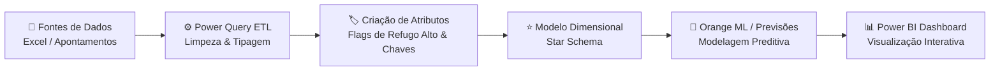
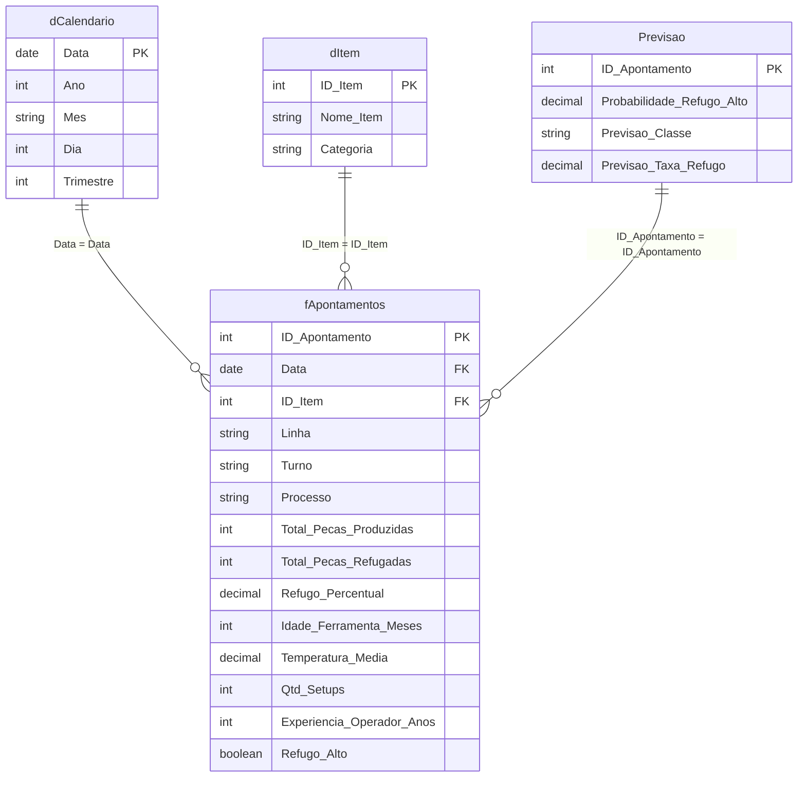

# 🏭 Inteligência Operacional & Analytics na Indústria de Manufatura
### Solução Integrada de Business Intelligence, Modelagem Relacional & Machine Learning Preditivo

[](https://powerbi.microsoft.com/)
[](https://www.microsoft.com/excel)
[](https://learn.microsoft.com/dax/)
[](https://learn.microsoft.com/power-query/)
[](https://orangedatamining.com/)
[](https://scikit-learn.org/)
[](LICENSE)

---

## 📌 Visão Geral do Projeto

Este projeto desenvolve uma solução completa de **Analytics Industrial e Manufatura Avançada**, desenhada para apoiar gerentes industriais, engenheiros de processos e operadores de chão de fábrica na identificação, controle e antecipação de falhas e taxas elevadas de refugo na linha de produção.

A partir de dados brutos de apontamentos de manufatura (temperatura do equipamento, quantidade de setups realizados, idade das ferramentas em meses, experiência do operador, turno e linha produtiva), o sistema combina **Data Analytics Clássico**, **Engenharia de Dados (ETL)**, **Modelagem Dimensional Relacional** e **Inteligência Artificial Preditiva (Machine Learning)**.

---

## 🏛️ A Estrutura Analítica Clássica em Data Analytics

O ecossistema analítico deste projeto foi concebido seguindo os 4 estágios da maturidade analítica em Data Analytics:

```
┌─────────────────┐      ┌─────────────────┐      ┌─────────────────┐      ┌─────────────────┐
│   DESCRITIVA    │ ───► │   DIAGNÓSTICA   │ ───► │    PREDITIVA    │ ───► │   PRESCRITIVA   │
│ O que aconteceu?│      │ Por que ocorreu?│      │O que vai ocorrer│      │   Como agir?    │
└─────────────────┘      └─────────────────┘      └─────────────────┘      └─────────────────┘
```

1. **Análise Descritiva (O que aconteceu?)**
   - Consolidação de volumes de produção por período, linha e turno.
   - Monitoramento do total de peças produzidas, total de peças conformes e volume de refugos.
   - Medição exata da taxa de refugo histórica (`Refugo_Percentual`).

2. **Análise Diagnóstica (Por que aconteceu?)**
   - Investigação de causas-raiz de falhas nos lotes produtivos.
   - Avaliação da influência do desgaste do ferramental (`Idade_Ferramenta_Meses`), temperatura de operação (`Mediana Temperatura`), frequência de trocas (`Mediana Setups`) e nível de qualificação da equipe (`Mediana Experiencia Operador`).
   - Identificação do ponto de inflexão operacional que dispara taxas anômalas de desperdício.

3. **Análise Preditiva (O que vai acontecer?)**
   - Aplicação de modelos treinados de **Machine Learning** via **Orange Data Mining**.
   - Classificação probabilística de apontamentos com risco iminente de refugo crítico (`Previsão de Total Peças Refugadas acima de 8%`).
   - Sinalização antecipada de linhas operacionais com alta probabilidade de desvio de qualidade.

4. **Análise Prescritiva (Como agir e otimizar?)**
   - Recomendações de plano de ação preventivo: balanceamento de operadores experientes em turnos críticos, revisões antecipadas de ferramentas e readequação de faixas térmicas ideais de maquinário.

---

## 🔄 Arquitetura de Dados & ETL com Power Query

O pipeline de dados assegura alta governança, integridade e consistência dos registros através de transformações estruturadas no **Power Query (M Script)**:



### Principais Etapas do Pipeline ETL:
- **Ingestão e Validação:** Leitura das planilhas de apontamento e histórico de itens.
- **Tipagem de Dados Estrita:** Tratamento de tipos datetime, numéricos inteiros e decimais contínuos, garantindo compatibilidade dimensional.
- **Engenharia de Recursos (Feature Engineering):** Geração da métrica condicional de refugo severo (`Refugo_Alto` quando `Refugo_Percentual > 8%`).
- **Dimensão Calendário Automatizada:** Criação da tabela `dCalendario` contendo atributos temporais (Ano, Mês, Trimestre, Dia da Semana) para suporte a análises temporais e Time Intelligence em DAX.

---

## 🗄️ Modelagem Relacional (Star Schema)

A modelagem de dados foi arquitetada no formato **Star Schema (Esquema Estrela)**, priorizando performance analítica no motor VertiPaq, simplicidade de navegação e integridade relacional:



### Tabelas do Modelo:
- **`fApontamentos` (Tabela Fato):** Centraliza todos os eventos de produção, quantitativos de peças e variáveis operacionais de processo.
- **`dCalendario` (Tabela Dimensão):** Provê continuidade temporal, hierarquias de data e filtragem por ano/mês.
- **`dItem` (Tabela Dimensão):** Contém os dados cadastrais e descrições técnicas dos produtos usinados/fabricados.
- **`Previsao` (Tabela Preditiva):** Armazena os escores gerados pelo pipeline de Machine Learning integrados por `ID_Apontamento`.
- **Tabelas de Métricas Separadas:** Organização de medidas DAX em pastas temáticas (`Análise Descritiva`, `Análise Diagnóstica`, `Análise Preditiva`).

---

## 📐 Engenharia de Métricas com DAX

As medidas foram construídas seguindo as melhores práticas de performance, utilizando variáveis (`VAR`), tratamento de divisões seguras com `DIVIDE` e funções de agregação estatística robustas:

```dax
-- Total de Peças Produzidas
Total Pecas Produzidas = 
SUM(fApontamentos[Pecas_Produzidas])

-- Total de Peças Refugadas
Total Pecas Refugadas = 
SUM(fApontamentos[Pecas_Refugadas])

-- Taxa Percentual de Refugo
Refugo_Percentual = 
DIVIDE([Total Pecas Refugadas], [Total Pecas Produzidas], 0)

-- Contagem de Apontamentos Críticos (Refugo > 8%)
Contagem de Apontamentos_Refugo_Alto = 
CALCULATE(
    COUNTROWS(fApontamentos),
    fApontamentos[Refugo_Alto] = TRUE()
)

-- Percentual de Apontamentos Severos
Percentual Apontamentos com Refugo Alto = 
DIVIDE([Contagem de Apontamentos_Refugo_Alto], [Total Apontamentos], 0)

-- Medianas Estatísticas de Diagnóstico Operacional
Mediana Temperatura = MEDIAN(fApontamentos[Temperatura_Media])
Mediana Idade Ferramenta = MEDIAN(fApontamentos[Idade_Ferramenta_Meses])
Mediana Setups = MEDIAN(fApontamentos[Qtd_Setups])
Mediana Experiencia Operador = MEDIAN(fApontamentos[Experiencia_Operador_Anos])
```

---

## 🤖 Inteligência Preditiva & Machine Learning (Orange Data Mining)

Para identificar com precisão quando um lote produtivo ultrapassará o patamar tolerável de 8% de perdas, foi implementado um fluxo preditivo de Data Mining no **Orange Canvas / Scikit-Learn**:

1. **Ingestão:** Importação da base consolidada de apontamentos históricos.
2. **Pré-Processamento:**
   - Normalização e padronização das variáveis contínuas (Temperatura, Idade do Ferramental, Horas de Operação).
   - Codificação de variáveis categóricas (Turno, Linha, Tipo de Processo).
3. **Seleção de Algoritmos:**
   - Comparação entre **Random Forest Classifier**, **Logistic Regression**, **Gradient Boosting** e **Decision Trees**.
   - Avaliação por validação cruzada (10-fold Cross-Validation) com foco em métricas de **Recall** e **AUC-ROC** para minimizar falsos negativos (evitar não prever lotes defeituosos).
4. **Exportação & Scoring:**
   - As probabilidades e predições foram agregadas à tabela `Previsao` e carregadas no modelo analítico do Power BI, viabilizando cruzamento direto com visuais e filtros temporais.

---

## 🖥️ Estrutura de Telas do Dashboard (Power BI)

O relatório `Projeto_ML.pbix` é estruturado em 4 páginas analíticas especializadas:

| Página | Foco Analítico | Principais Indicadores e Visuais |
| :--- | :--- | :--- |
| **1. Processo** | Monitoramento Operacional | Volume produzido, volume de refugo, taxa global de defeitos e distribuição por processo fabril. |
| **2. Ferramenta** | Diagnóstico de Maquinário | Idade média do ferramental, correlação entre desgaste (meses de uso) e taxa de perdas, análise de trocas e setups. |
| **3. Turno e Linha** | Gestão de Desempenho Humano & Setorial | Ranking de linhas produtivas, performance comparativa entre turnos de trabalho e experiência média de operadores. |
| **4. Quais são as projeções e tendências?** | Inteligência Preditiva | Apontamentos com alto risco de refugo futuro, curva de tendência projetada e estimativa de perdas evitáveis. |

---

## 📁 Estrutura do Repositório

```text
Industria-Producao/
├── Projeto_ML.pbix         # Arquivo principal do relatório e modelo analítico Power BI
├── connect_remote.ps1      # Script PowerShell para conexão remota e publicação automática
├── connect_remote.bat      # Script Batch Windows de automação de push
├── requirements.txt        # Dependências Python para pipelines de ML e análise de dados
├── .env.example            # Template seguro de variáveis de ambiente e conexões
├── .gitignore              # Regras robustas de exclusão de temporários, logs e segredos
├── .gitattributes         # Configuração de arquivos binários e quebras de linha
└── README.md               # Documentação técnica e estratégica do projeto
```

---

## 🚀 Como Executar e Conectar o Repositório

### 1. Clonar o Repositório
```bash
git clone https://github.com/bibianodenis-dev/Industria-Producao.git
cd Industria-Producao
```

### 2. Abrir o Dashboard no Power BI Desktop
- Certifique-se de possuir a versão mais recente do **Power BI Desktop** instalada.
- Abra o arquivo [`Projeto_ML.pbix`](file:///c:/Users/bibia/OneDrive/Área%20de%20Trabalho/Power%20BI/Industria-Producao/Projeto_ML.pbix).

### 3. Executar o Script de Sincronização e Publicação
Para vincular e enviar atualizações automaticamente ao GitHub:
```powershell
.\connect_remote.ps1
```
Ou no Prompt de Comando:
```cmd
connect_remote.bat
```

---

## 🔒 Auditoria de Segurança & Boas Práticas DevOps

- **Varredura de Segredos (Secret Scanning):** O repositório foi examinado contra chaves de API, senhas, tokens e credenciais embutidas. Nenhum segredo foi detectado.
- **Isolamento de Configurações Sensíveis:** Arquivo [`.env.example`](file:///c:/Users/bibia/OneDrive/Área%20de%20Trabalho/Power%20BI/Industria-Producao/.env.example) fornecido como padrão para futuras conexões de bancos de dados ou gateways corporativos.
- **Gitignore Otimizado:** Bloqueio preventivo de arquivos temporários do Microsoft Office (`~$*.xlsx`), cache de runtime e arquivos de despejo.

---

## 👤 Autor

**Denis Bibiano**  
GitHub: [@bibianodenis-dev](https://github.com/bibianodenis-dev)  
E-mail: bibiano.denis@gmail.com  
Projeto: [Industria-Producao](https://github.com/bibianodenis-dev/Industria-Producao.git)
